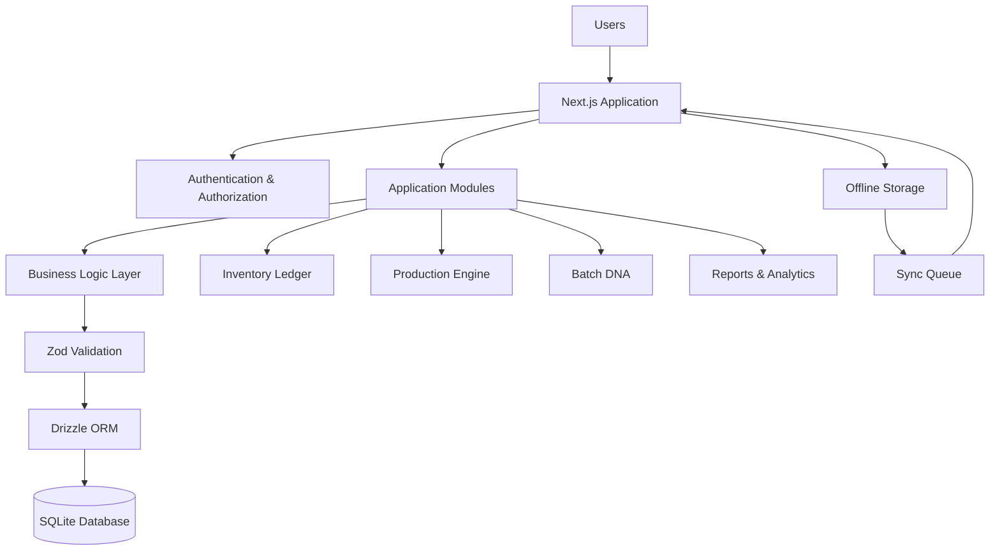

# GRAINTRACE
### Every packet produced. Every gram accounted for.

<p align="center">
  **Manufacturing Intelligence · Inventory Traceability · Production Accountability**
</p>

<p align="center">
  
  
  
  
</p>

<p align="center">
  <em>One factory. One connected system. Complete accountability.</em>
</p>

---

## Overview

**GRAINTRACE** is a manufacturing traceability and operational management platform designed for small and growing food manufacturing businesses.

It connects customer orders, procurement, raw materials, inventory, recipes, production, costing, finished goods, dispatch, invoicing, and payments into one unified system.

Instead of managing operations across disconnected spreadsheets and manual records, GRAINTRACE creates a connected manufacturing workflow where every material movement and production activity can be tracked.

### The core idea

> From raw material procurement to the final customer delivery, every step should be traceable, measurable, and accountable.

---

## The Problem We're Solving

Manufacturing businesses often face challenges such as:

- Disconnected records across purchasing, inventory, and production.
- Difficulty tracking raw materials and supplier batches.
- Limited visibility into actual material consumption.
- Inaccurate production costing and yield calculations.
- Delayed identification of stock shortages and wastage.
- Complicated order fulfilment and payment tracking.
- Difficulty tracing finished products back to their raw material sources.

**GRAINTRACE brings these operations together through a centralized manufacturing intelligence platform.**

---

## Platform Features

| Module | Key Capabilities |
|---|---|
| Factory Dashboard | Production overview, stock alerts, pending orders, operational activity |
| User Management | Role-based access for Owner, Admin, Salesman, Production, and Accountant |
| Customer Management | Customer profiles, GST details, addresses, credit terms, order history |
| Sales Orders | Order creation, approval, pricing, discounts, partial fulfilment |
| Procurement | Supplier management, purchase orders, goods receipt, material batches |
| Inventory | Raw materials, packaging, finished goods, stock ledger, expiry alerts |
| Recipe & BOM | Material requirements, recipe configuration, estimated production cost |
| Production | Production runs, material consumption, yield, wastage, costing |
| Batch DNA | End-to-end raw material to finished product traceability |
| Production Analytics | Planned vs actual consumption, yield variance, cost per packet |
| GST Invoicing | Tax calculations, invoice generation, payment tracking |
| Dispatch | Batch allocation, delivery status, partial dispatch, backorders |
| Payments | Collections, outstanding balances, overdue tracking |
| Reports | Inventory, production, sales, costing, GST, and financial reports |
| Audit Trail | User actions, timestamps, changes, and source references |
| Offline Support | Local drafts, queued transactions, synchronization, retry handling |

---

## Batch DNA — Complete Product Traceability

**Batch DNA is the traceability core of GRAINTRACE.**

It connects every stage of a product's manufacturing journey.

```text
SUPPLIER
   |
   v
PURCHASE ORDER
   |
   v
RAW MATERIAL LOTS
   |
   v
INVENTORY MOVEMENTS
   |
   v
RECIPE / BILL OF MATERIALS
   |
   v
PRODUCTION RUN
   |
   v
MATERIAL CONSUMPTION
   |
   v
YIELD & COST ANALYSIS
   |
   v
FINISHED GOODS BATCH
   |
   v
DISPATCH & INVOICE
   |
   v
CUSTOMER
```

### What makes it valuable?

- Trace finished products back to their original suppliers.
- Identify the raw material lots used in production.
- Track material consumption and production yield.
- Investigate wastage and production variances.
- Trace affected finished batches to their customers.
- Navigate forward and backward through the product lifecycle.

**Every packet has a production history. Every material has an accountable destination.**

---

## Technology Stack

| Layer | Technology |
|---|---|
| Frontend | Next.js 14 App Router |
| Language | TypeScript |
| Styling | Tailwind CSS |
| UI Components | shadcn/ui |
| Animations | Framer Motion |
| Charts | Recharts |
| Database | SQLite |
| ORM | Drizzle ORM |
| Validation | Zod |
| Testing | Vitest |
| Excel Reports | ExcelJS |
| PDF Documents | @react-pdf/renderer |
| Offline Storage | IndexedDB |
| Application Type | Progressive Web App |

---

## System Architecture



---

## Engineering Principles

GRAINTRACE is designed around data integrity and manufacturing accountability.

- **Ledger-based inventory:** Stock balances are derived from recorded movements.
- **Traceable transactions:** Every stock movement references its source.
- **Accurate costing:** Monetary values are stored in integer paise.
- **Reliable production:** Planned and actual consumption are compared.
- **Controlled fulfilment:** Negative stock and duplicate posting are prevented.
- **GST accuracy:** Tax calculations distinguish intra-state and inter-state transactions.
- **Auditability:** Important changes retain user and timestamp information.
- **Offline resilience:** Queued transactions are designed for safe synchronization.

---

## Benchmark & Validation

The prototype includes a defined manufacturing benchmark to validate its business logic.

| Validation Item | Expected Result |
|---|---:|
| Flour closing stock | 120 kg |
| Oil closing stock | 19.5 L |
| Pouches closing stock | 306 |
| Cartons closing stock | 21 |
| Spice closing stock | 3.8 kg |
| Finished goods after production | 238 packets |
| Finished goods after Retailer A dispatch | 88 packets |
| Yield variance | -6% |
| Oil consumption variance | +5% |
| Retailer A taxable invoice | ₹7,500 |
| CGST | ₹187.50 |
| SGST | ₹187.50 |
| Invoice total | ₹7,875 |
| Payment received | ₹4,000 |
| Outstanding amount | ₹3,875 |
| Distributor B shortage | 32 packets |

*These are benchmark targets, not a claim that every result has already been implemented or verified. Actual completion should be reported after running the benchmark tests.*

---

## Screenshots & Product Preview

Add actual application screenshots here as development progresses.

| Factory Dashboard | Inventory Management |
|---|---|
| <!-- Add dashboard screenshot --> | <!-- Add inventory screenshot --> |

| Production Management | Batch DNA Traceability |
|---|---|
| <!-- Add production screenshot --> | <!-- Add Batch DNA screenshot --> |

| Sales & Invoicing | Reports & Analytics |
|---|---|
| <!-- Add sales screenshot --> | <!-- Add reports screenshot --> |

---

## Getting Started

### Prerequisites

- Node.js
- npm
- Git

### 1. Clone the repository

```bash
git clone YOUR_REPOSITORY_URL
cd graintrace
```

### 2. Install dependencies

```bash
npm install
```

### 3. Configure environment variables

Create a `.env` file using the environment variables required by the application.

### 4. Initialize the database

Run the project's configured Drizzle migration and seed commands.

```bash
npx drizzle-kit migrate
```

### 5. Start the development server

```bash
npm run dev
```

Open:

```text
http://localhost:3000
```

### 6. Run tests

```bash
npm run test
```

### 7. Create a production build

```bash
npm run build
```

*Check the actual package scripts and environment requirements in the repository before running these commands.*

---

## Development Roadmap

- [ ] Foundation and design system
- [ ] Database architecture and authentication
- [ ] Core business logic and benchmark validation
- [ ] Procurement and inventory management
- [ ] Production management and Batch DNA
- [ ] Sales orders, GST invoicing, and dispatch
- [ ] Payments, reports, and audit trail
- [ ] Offline support and PWA capabilities
- [ ] Engineering and security validation
- [ ] UI refinement and responsive optimization
- [ ] Final demonstration preparation

---

## Future Scope

- Advanced manufacturing analytics.
- Predictive inventory planning.
- Supplier performance insights.
- Automated production recommendations.
- Enhanced mobile-first factory workflows.
- Multi-factory support.
- Advanced traceability and quality-control integrations.

---

## Why GRAINTRACE?

Traditional manufacturing records tell businesses what happened.

**GRAINTRACE aims to show how it happened, why it happened, what it cost, and where every material went.**

It transforms disconnected manufacturing activities into a connected and accountable operational workflow.

---

## Project Information

| Detail | Description |
|---|---|
| Project | GRAINTRACE |
| Category | Manufacturing Management & Traceability |
| Domain | Food Manufacturing |
| Application | Web Application / PWA |
| Architecture | Full-stack |
| Development Status | Prototype |
| Primary Focus | Operational Visibility & Accountability |

---

<p align="center">
  <strong>GRAINTRACE</strong><br/>
  Every packet produced. Every gram accounted for.
  <br/><br/>
  <sub>Built to bring clarity, control, and accountability to manufacturing.</sub>
</p>
